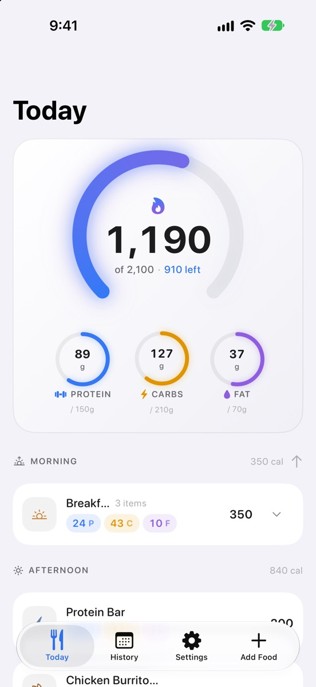
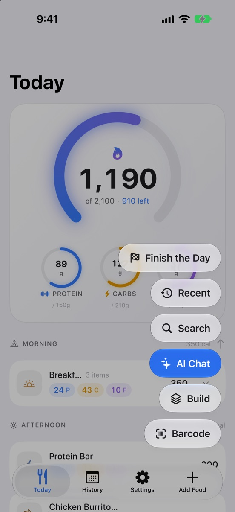
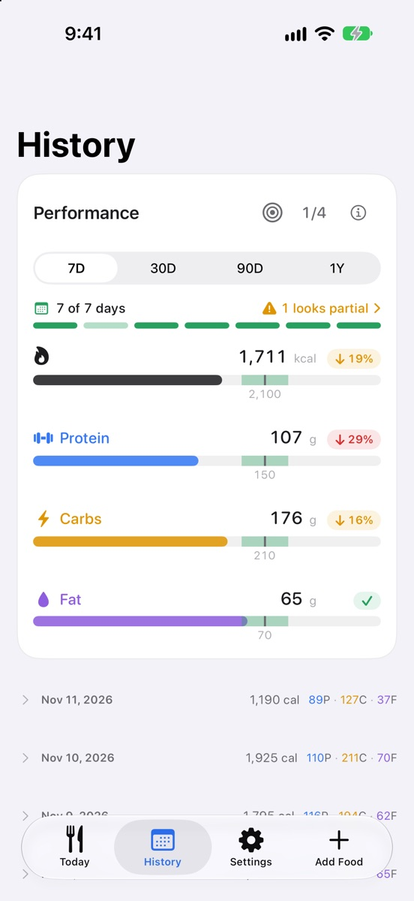
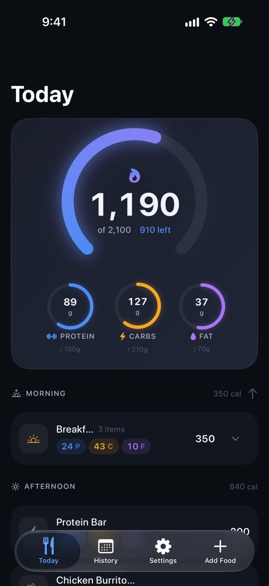

# FoodTracker

A personal iOS calorie and macro tracker built with SwiftUI and SwiftData. You log food by telling an AI what you ate (a photo, a sentence, or both), scanning a barcode, or re-adding something you eat often. The app then helps you land the day on your calorie, protein, carb and fat goals, with guidance rather than judgment: landing slightly over a goal earns a green check.

<p align="center">
  
  
  
  
</p>

*Screenshots use demo data.*

## A day with the app

1. **Morning:** opening the app brings up **Daily Kickstart**, which offers the foods and meals you usually have by this time and haven't logged yet. Tick and add them in one go.
2. **During the day:** tap **+** and choose how to log. **AI Chat** takes up to four photos and/or a description, talks it through with you ("that was half a portion"), and logs exactly what you agreed to. **Barcode** looks the product up on OpenFoodFacts. **Recent** and **Search** re-add your own foods, or find USDA results, an AI estimate or a manual entry.
3. **Evening:** **Finish the Day** looks at what's left of each goal and suggests three different, realistically sized snacks or small meals, built mostly from foods you actually eat. Pick whole options or single items, recalculate, ask for something else ("no bars", "something warm"), or photograph what's in the fridge and let it plan around that.
4. **Over time:** **History** shows past days and your average calories and macros over 7, 30, 90 and 365 days against your goals. Today and days that look half-logged are left out, so they don't drag the averages down.

## Features

### Logging
- **AI Chat:** a conversation, not a one-shot guess. It sees your photos, asks when something is unclear, and logs a meal as a group of items.
- **Barcode scanning** via OpenFoodFacts. A missing product can be added by typing the label in or photographing the package (the AI reads the label), and is then submitted to OpenFoodFacts so the next scan finds it.
- **Community corrections:** fix a scanned product's numbers or serving size and the app offers to send the correction to OpenFoodFacts, exactly as typed.
- **Search:** your own foods first, then USDA FoodData Central (with cooking-method matching and prepared foods), an AI estimate and manual entry.
- **Recent and Favorites:** frequent foods, recent foods and meals, and starred items, one tap away.
- **Build a meal** from ingredients added in any of the ways above.
- **Amount eaten:** when the serving weight is known, type the grams you ate and the servings follow.

### Staying on track
- **Calorie gauge:** the whole arc is your goal; as you get close it opens up to show a goal line, and anything past the goal is drawn in red.
- **Macro rings** that keep their colors and show a check when you're on target (within ±10%).
- **Entries by time of day** (morning, afternoon, evening) with swipe actions and drag-to-reorder between sections.
- **Daily Kickstart** and **Finish the Day**, as described above. Both can be turned off in Settings.
- **Performance averages** with a dot per day, partial-day detection, and the option to leave a day out.

### Everything else
- **Detail views** with full-bleed photos, or an illustration from Apple Image Playground when there's no photo.
- **Estimation accuracy:** records your corrections to AI estimates and shows any systematic bias, by source and model.
- **Shake to send feedback:** screenshots the screen, lets you draw on it, and an AI asks a couple of follow-up questions before it's emailed.
- **Apple Health sync** for calories, protein, carbs and fat.
- **Home Screen widget** with calories left and macro progress.
- **CSV import and export** of the whole food log.
- **Liquid Glass design** on iOS 26 and later, with a left-handed layout option and light, dark or system appearance.

## AI: Claude, with your own key

Every AI feature (AI Chat, AI estimates, label reading, Finish the Day and the feedback questions) runs on Claude from Anthropic.

- **You need your own Anthropic API key.** Create one at [console.anthropic.com](https://console.anthropic.com) and enter it in the app under **Settings → Claude AI**. Usage is billed to your own Anthropic account; the app has no backend and no shared key.
- **Pick the model** in the same section. The list comes live from Anthropic, so new models show up without an app update, and a retired model is replaced automatically. The default is Sonnet 4.6.
- Without a key, everything else (barcode scanning, search, manual entry, history) still works.

Nutrition data comes from USDA FoodData Central and OpenFoodFacts.

## Tech Stack

- **Language:** Swift, SwiftUI
- **Data:** SwiftData (a single `FoodEntry` model), shared with the widget through an App Group
- **Minimum target:** iOS 17; Liquid Glass and the native tab bar on iOS 26 and later
- **Dependencies:** none, Apple frameworks only
- **No backend:** the app talks to Anthropic, USDA and OpenFoodFacts directly with your own keys

## Building

1. Clone and open `FoodTracker.xcodeproj` in Xcode 26 or later.
2. For both the FoodTracker and FoodTrackerWidgetExtension targets, open **Signing & Capabilities**:
   - Select your Apple Developer team.
   - Add the **App Groups** capability with `group.com.DNT.foodtracker`.
3. On the FoodTracker target, add the **HealthKit** capability.
4. Optional: create `Secrets.xcconfig` (gitignored) with `FEEDBACK_EMAIL = you@example.com` so shake feedback has a recipient. Without it, feedback goes through the share sheet.
5. Build for a simulator or device. The camera and barcode scanner need a physical device.

## API Keys

Nothing is hardcoded. Open **Settings** to enter:

- **Anthropic API key (Settings → Claude AI):** your own key, needed for every AI feature. Usage is billed to your Anthropic account.
- **USDA FoodData Central key:** optional but recommended. Free at [fdc.nal.usda.gov/api-key-signup](https://fdc.nal.usda.gov/api-key-signup) (1,000 requests an hour, compared with 30 for the shared `DEMO_KEY`).
- **OpenFoodFacts username and password:** optional, only needed to submit products and corrections.

Keys are stored in the Keychain with `kSecAttrAccessibleWhenUnlockedThisDeviceOnly`, so they never sync to iCloud.

## Project Structure

```
FoodTracker/
├── Models/             # SwiftData FoodEntry
├── Shared/             # Design system, shared views and helpers, constants, planners and calculators
├── Services/           # AI chat and vision, Finish the Day, feedback, USDA, OpenFoodFacts, HealthKit, Image Playground
└── Views/              # SwiftUI screens
FoodTrackerWidget/      # WidgetKit extension
scripts/                # pull-feedback.sh copies feedback reports saved on test phones
docs/screenshots/       # Images used in this README
```

See [`CLAUDE.md`](./CLAUDE.md) for a detailed architectural walkthrough.
